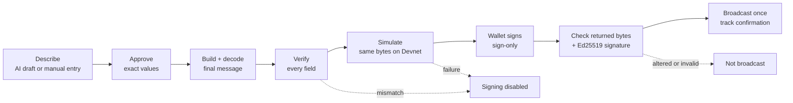
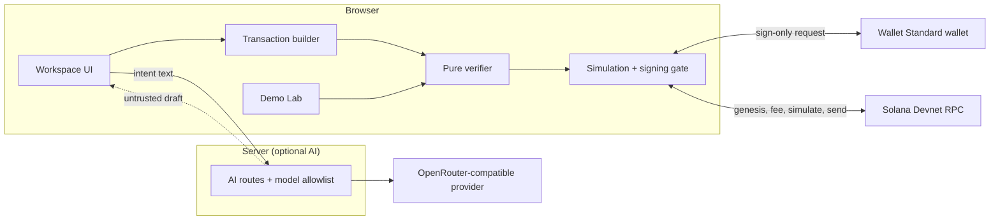

<div align="center">


# IntentShield

### Know what you sign.

**AI-assisted Solana transfers, verified against the exact transaction bytes before your wallet is asked to sign.**

[](https://intent-shield-self.vercel.app) [](https://explorer.solana.com/?cluster=devnet) [](https://github.com/lidxgoesgiri/IntentShield/actions/workflows/ci.yml) [](https://events.mlh.com/events/15200-solana-hackathon)

[**Live app**](https://intent-shield-self.vercel.app) · [**Demo Lab**](https://intent-shield-self.vercel.app/app/demo) · [**Demo video**](https://youtu.be/eTGk3J56Zss) · [**Security**](SECURITY.md)

</div>

> [!IMPORTANT]
> **AI drafts. Deterministic code verifies. You decide.** IntentShield compares what your wallet will sign with what you approved, field by field. A match confirms the transaction is the one you intended; it does not rate the recipient.

## 📚 Contents

[Demo](#demo) · [Why IntentShield](#why-intentshield) · [Features](#features) · [How it works](#how-it-works) · [Security model](#security-model) · [Tech stack](#tech-stack) · [Architecture](#architecture) · [Getting started](#getting-started) · [AI configuration](#ai-configuration) · [Devnet transfer](#devnet-transfer) · [Testing](#testing) · [Scope](#scope) · [Hackathon](#hackathon) · [Roadmap](#roadmap) · [Contributing](#contributing) · [License](#license)

<a id="demo"></a>

## 🎬 Demo

<div align="center">

[](https://youtu.be/eTGk3J56Zss)

</div>

A walkthrough of under two minutes, covering:

- plain-English drafting;
- exact-message verification and Devnet simulation;
- controlled mismatch tests;
- a real 0.01 SOL transfer on Solana Devnet signed with Phantom, through to a finalized receipt and Solana Explorer.

No wallet? Open the [Demo Lab](https://intent-shield-self.vercel.app/app/demo) or the [landing simulator](https://intent-shield-self.vercel.app/#simulator). Both run the production verifier on controlled samples and move no funds.

<a id="why-intentshield"></a>

## 💡 Why IntentShield

A wallet's **Sign** button is a high-stakes moment. A recipient address, an amount in lamports, or a list of instructions is hard to connect to what you actually meant to do. Approving without that connection is **blind signing**, and one changed digit or lookalike address is enough to send funds somewhere you never intended.

IntentShield closes that gap for native SOL transfers:

- **Say it in plain English.** An AI model turns your request into an editable draft. It never authorizes anything.
- **Approve exact values.** You confirm the amount and the full recipient address. Any edit discards the approval.
- **Verify the real bytes.** Deterministic code decodes the exact message your wallet will sign and checks it against your approval, then simulates those same bytes on Devnet.
- **Sign at a verified boundary.** The wallet must return the same bytes with a valid signature, or nothing is broadcast.

<a id="features"></a>

## ✨ Features

| | Feature | What it does |
|---|---|---|
| 🧠 | **AI intent parsing** | Turns plain language into a schema-validated, editable draft. A recipient must appear verbatim in your text, and an amount must be written literally. |
| 🔀 | **Model switcher** | Choose a model from a server-side allowlist; the UI shows which model answered and when a fallback was used. |
| ✍️ | **Manual entry** | Enter the recipient and amount directly; every check still runs without AI. |
| 🔍 | **Exact-message verification** | Compares action, sender, recipient, amount, fee payer, program, network, and instructions against your approval. |
| 🧪 | **Devnet simulation** | Balance and fee preflight, then an RPC simulation of the same unsigned bytes before signing. |
| 🔏 | **Verified signing boundary** | Sign-only Wallet Standard request; the returned bytes and the Ed25519 signature are checked before broadcast. |
| 🧾 | **Honest receipts** | Tracks submitted, confirming, and confirmed states separately, with a Devnet Explorer link and wallet-scoped recovery. |
| 🧫 | **Security Demo Lab** | Exact match, changed amount, lookalike recipient, extra instruction, and bytes mutated after review, all through the real verifier. |

<a id="how-it-works"></a>

## 🧭 How it works



1. **Describe.** Type a request such as `Send 0.01 SOL to <full address>`, or enter the fields manually.
2. **Approve.** Approval fixes the sender, full recipient, amount in lamports, and network.
3. **Verify.** The app compiles the final message and decodes those exact bytes; it never trusts the draft or a UI summary.
4. **Simulate.** The same bytes must simulate successfully on Devnet; a timeout or unreadable answer keeps signing disabled.
5. **Sign.** Your wallet signs without sending. IntentShield broadcasts only if the wallet returned the reviewed bytes, validly signed by your account.
6. **Confirm.** The receipt reads *Confirmed* only when the RPC reports `confirmed` or `finalized` with no error.

<a id="security-model"></a>

## 🛡️ Security model

| ✅ Verified deterministically | 🤖 Assisted by AI (untrusted) | 🚫 Outside scope |
|---|---|---|
| One native System Program transfer, plus the app's fixed compute budget | Turning a sentence into an editable draft | Recipient reputation or scam detection |
| Sender and fee payer are your wallet | Optional plain-language explanation of a verdict | Phishing sites, compromised wallets or browsers |
| Full recipient address and integer lamports | | SPL tokens, swaps, NFTs, other programs |
| Solana Devnet, proven by the RPC genesis hash | | Mainnet |
| Same bytes simulated, signed, and broadcast | | |

The verifier is a pure function with no AI, wallet, RPC, or UI dependency, and it fails closed: anything it cannot decode or verify keeps signing disabled. Trust boundaries, the threat model, and implementation details are documented in **[SECURITY.md](SECURITY.md)**.

<a id="tech-stack"></a>

## 🧰 Tech stack

| Layer | Technologies |
|---|---|
| **App** | Next.js 16 (App Router), React 19, TypeScript 6 (strict) |
| **Solana** | `@solana/kit` 8, `@solana/react`, `@solana/kit-plugin-wallet` (Wallet Standard), `@solana-program/system` |
| **UI** | Tailwind CSS 4, Radix UI, lucide-react, GSAP (landing motion, reduced-motion aware) |
| **Validation** | Zod 4 |
| **AI** | OpenRouter-compatible API, called server-side only |
| **Testing** | Vitest 5, Testing Library, Playwright 1.65, axe-core |

Exact versions are pinned in [`package.json`](package.json). There is no custom on-chain program: transfers use Solana's native System Program.

<a id="architecture"></a>

## 🏗️ Architecture



<details>
<summary><strong>Project structure, key modules, and routes</strong></summary>

```text
src/
├── app/                 # Landing, workspace, Demo Lab, receipt page, API routes
├── components/          # Shared layout and UI primitives
├── config/              # Environment validation and Devnet-only product scope
├── features/
│   ├── intent/          # Draft parsing, model selection, approval
│   ├── verification/    # Message decoding and deterministic checks
│   ├── transfer/        # State machine, simulation, signing, submission
│   ├── wallet/          # Wallet Standard connection and balance
│   ├── receipt/         # RPC receipts and wallet-scoped recovery
│   ├── demo/            # Controlled verifier scenarios
│   └── landing/         # Landing page, motion, sample simulator
├── lib/solana/          # RPC adapter and network guard
├── server/              # AI client, request limits, safe logging
└── styles/              # Design tokens
tests/                   # Unit, integration, and Playwright end-to-end suites
scripts/                 # Fixture generation, opt-in Devnet smoke test
```

| Module | Responsibility |
|---|---|
| [`verify-native-sol-transfer.ts`](src/features/verification/lib/verify-native-sol-transfer.ts) | Pure transaction verifier |
| [`sign-transfer.ts`](src/features/transfer/lib/sign-transfer.ts) | Byte and signature checks at the wallet boundary |
| [`machine.ts`](src/features/transfer/machine.ts) | Transfer state machine and guards |
| [`rpc.ts`](src/lib/solana/rpc.ts) | Devnet RPC adapter |
| [`src/server/ai/`](src/server/ai/) | Model allowlist, provider calls, fallback, handlers |

| Route | Purpose |
|---|---|
| `/` · `/app` · `/app/demo` | Landing, transfer workspace, Demo Lab |
| `/tx/[signature]` | Devnet receipt for a supplied signature |
| `POST /api/ai/parse-intent` | Untrusted, schema-validated transfer draft |
| `POST /api/ai/explain` | Optional explanation of an existing verdict (receives no addresses) |
| `GET /api/ai/models` | Allowlisted model IDs, labels, and availability |
| `GET /api/health` | Service and cluster status |

</details>

<a id="getting-started"></a>

## 🚀 Getting started

**Prerequisites:** Node.js 24+ and npm. For real transfers you also need a Wallet Standard wallet that supports `solana:signTransaction` (for example Phantom) and some Devnet SOL.

```bash
git clone https://github.com/lidxgoesgiri/IntentShield.git
cd IntentShield
npm ci
cp .env.example .env.local   # PowerShell: Copy-Item .env.example .env.local
npm run dev                  # http://localhost:3000
```

The template works out of the box with manual entry. To enable AI drafting, see [AI configuration](#ai-configuration).

<details>
<summary><strong>Environment variables</strong></summary>

| Variable | Scope | Default / purpose |
|---|---|---|
| `NEXT_PUBLIC_SOLANA_RPC_URL` | Browser | `https://api.devnet.solana.com`; must report Devnet's genesis hash |
| `NEXT_PUBLIC_SOLANA_CLUSTER` | Browser | `devnet`; any other value is rejected |
| `NEXT_PUBLIC_APP_URL` | Browser | Public app URL for metadata |
| `NEXT_PUBLIC_REPOSITORY_URL` | Browser | Repository link shown in the UI |
| `NEXT_PUBLIC_DOCS_URL` | Browser | Optional; defaults to the repository README |
| `OPENROUTER_API_KEY` | Server only | Provider key; AI stays off while empty |
| `OPENROUTER_MODEL` | Server only | Default model ID (or a comma-separated list, first is the default) |
| `OPENROUTER_MODELS` | Server only | Optional extra allowlisted model IDs |
| `AI_BASE_URL` | Server only | `https://openrouter.ai/api/v1` or another compatible endpoint |
| `AI_REQUESTS_PER_MINUTE` | Server only | `10`; per-client request limit |
| `AI_DAILY_REQUEST_BUDGET` | Server only | `500`; daily provider-attempt budget per process |

Never prefix a secret with `NEXT_PUBLIC_`.

</details>

| Script | Purpose |
|---|---|
| `npm run dev` | Development server |
| `npm run build` · `npm start` | Production build (Webpack) and server |
| `npm run lint` · `npm run typecheck` | ESLint with architectural import rules; TypeScript with typed routes |
| `npm test` · `npm run test:e2e` | Vitest suites; Playwright end-to-end suites |
| `npm run smoke:devnet` | Opt-in live Devnet pipeline test that sends a real transaction from a disposable key |

<a id="ai-configuration"></a>

## 🤖 AI configuration

1. Create a key in [OpenRouter](https://openrouter.ai/settings/keys) and set `OPENROUTER_API_KEY` in `.env.local`.
2. Set `OPENROUTER_MODEL` to an exact ID from the [OpenRouter model catalog](https://openrouter.ai/models); there is no built-in default.
3. Optionally list more IDs in `OPENROUTER_MODELS` (up to 12 allowlisted models in total), then restart the server.

| Situation | Behavior |
|---|---|
| AI not configured | AI routes answer `503 AI_UNAVAILABLE`; manual entry stays available |
| Model outside the allowlist | Rejected with `400` before any provider call |
| Model fails or returns invalid output | One fallback attempt; models that just failed cool down for 60 seconds |
| No model answers | The app says AI is unavailable and offers manual entry |

Requests are bounded: 300-character input, an 8-second timeout per call within an 18-second total budget, and capped response sizes. The model choice never reaches the verifier, the simulation, or the signing gate.

<a id="devnet-transfer"></a>

## 🌐 Make a Devnet transfer

1. **Enable Devnet in Phantom:** Settings → Developer Settings → Testnet Mode → Solana Devnet ([Phantom guide](https://help.phantom.com/articles/view-testnets-in-phantom-5997313271699)).
2. **Get free Devnet SOL** from the [Solana Faucet](https://faucet.solana.com/). Devnet SOL has no monetary value.
3. **Connect** your wallet in the [workspace](https://intent-shield-self.vercel.app/app) and check the Devnet indicator.
4. **Describe** a small transfer to another address, for example `Send 0.01 SOL to <full recipient address>`, or choose **Enter Manually**.
5. **Review, approve, and sign** once *Intent Matched* and *Simulation passed* appear; your wallet shows its own confirmation.
6. **Open the receipt** and follow its Solana Explorer link (`cluster=devnet`).

<a id="testing"></a>

## 🧪 Testing

| Suite | Result (local run, 8 Nov 2026) |
|---|---|
| Vitest unit + integration | **419 / 419 passed** across 31 files |
| Playwright end-to-end (test wallet, mocked RPC and AI) | **113 / 113 passed** across 15 files |
| Lint, typecheck, production build | **Passed** |

The suites cover:

- amount precision and the literal AI guards;
- byte-level tampering, lookup tables, and wrong networks;
- wallet rejection, mutation, and forged signatures;
- duplicate clicks, expiry, and ambiguous submissions;
- receipt privacy, accessibility (axe), keyboard navigation, reduced motion, and responsive layouts.

[GitHub Actions](https://github.com/lidxgoesgiri/IntentShield/actions/workflows/ci.yml) runs the quality and end-to-end jobs on every pull request and every push to `main`.

```bash
npx playwright install chromium   # first run only
npm run test:e2e                  # builds and serves on port 3100
```

| Evidence | Real Devnet? | Funds moved? |
|---|---|---|
| Demo Lab and landing simulator | No, controlled fixtures | No |
| Vitest and Playwright suites | No, mocked services | No |
| `npm run smoke:devnet` | Yes, disposable test key | Devnet SOL only |
| Phantom transfer in the [demo video](https://youtu.be/eTGk3J56Zss) | Yes, finalized on Devnet | 0.01 Devnet SOL |

<a id="scope"></a>

## 📍 Scope & limitations

- **Native SOL on Solana Devnet**, up to 1 SOL per transfer. No mainnet, SPL tokens, NFTs, swaps, or arbitrary programs.
- **Intent matching is not a trust score.** It proves the transaction matches your approval, not that the recipient is safe.
- **Review AI drafts.** Guards reject invented addresses and amounts, but you approve every value.
- **Requires a sign-only wallet.** Wallets that can only sign-and-send cannot pass the verification boundary. Wallets that rewrite the reviewed bytes are refused.
- **No independent security audit yet.**

See [SECURITY.md](SECURITY.md) for the full threat model and technical limits.

<a id="hackathon"></a>

## 🏆 Hackathon

Built for the **[MLH Solana Hackathon 2026](https://events.mlh.com/events/15200-solana-hackathon)** (6–8 November 2026, online) by [lidxgoesgiri](https://github.com/lidxgoesgiri), working solo.

| Track | Why IntentShield fits |
|---|---|
| **AI Track** | The event lists *natural-language interfaces that turn plain requests into transactions, with clear confirmation before signing* and *security tools that explain what a transaction will do* as example ideas. Here AI does the drafting while Solana does the settlement. |
| **Top 3 Overall** | A working end-to-end product on Solana Devnet with a live deployment, reproducible demos, and automated tests. |

**AI assistance disclosure:** Claude Code (Anthropic) and Codex (OpenAI) assisted with implementation, testing, review, and documentation under the maintainer's direction and review. At runtime, the app optionally calls an OpenRouter-compatible model for drafts and explanations only.

IntentShield is not affiliated with MLH, the Solana Foundation, or any wallet provider.

<a id="roadmap"></a>

## 🗺️ Roadmap

- **SPL token transfers** with mint and decimal checks.
- **Instruction previews** for selected dApp programs.
- **Broader wallet coverage** and an independent security review.
- **Mainnet**, only after that review and additional risk controls.

Every extension keeps the same rule: AI assists, deterministic checks decide, and the user signs.

<a id="contributing"></a>

## 🤝 Contributing

Issues and focused pull requests are welcome. Please:

1. Use a short-lived branch and [Conventional Commits](https://www.conventionalcommits.org/).
2. Run `npm run lint`, `npm run typecheck`, `npm test`, and `npm run build`; add `npm run test:e2e` when the user flow changes.
3. Add regression tests for any change to verification or signing.
4. Open a pull request against `main` using the [template](.github/pull_request_template.md).

Report vulnerabilities privately as described in [SECURITY.md](SECURITY.md).

<a id="license"></a>

## 📄 License & acknowledgments

No open-source license has been chosen yet, so standard copyright applies. Please [open an issue](https://github.com/lidxgoesgiri/IntentShield/issues) to discuss reuse.

Fonts: [Basement Grotesque](https://github.com/basementstudio/basement-grotesque) by basement.studio ([SIL OFL 1.1](src/app/fonts/basement-grotesque/LICENSE.txt)), Instrument Sans, and IBM Plex Mono. Third-party dependencies keep their own licenses.
