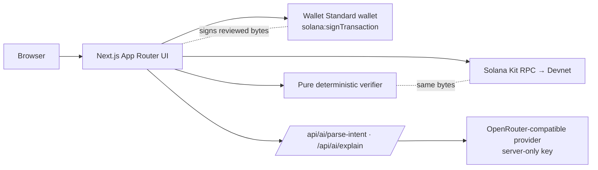

<p align="center">
  
</p>

<h1 align="center">IntentShield</h1>
<p align="center"><strong>Know what you sign.</strong><br/>Plain-language Solana transfers, verified deterministically against the exact message — before your wallet is asked to sign.</p>

<p align="center">Solana Devnet · non-custodial · native SOL transfers only · built for the Solana Hackathon 2026 (MLH)</p>

---

## What it does

1. **Describe** a transfer in plain language (`Send 0.1 SOL to <full address>`) — or type the fields manually.
2. **AI drafts, never decides.** A server-side model proposes an editable draft. Deterministic guards discard any recipient that is not *verbatim* in your text and any amount you did not literally write.
3. **Approve the exact values.** Approval freezes `{sender, recipient, lamports, devnet}`; editing anything discards it.
4. **Build → decode → verify the final message.** The app compiles one System Program `Transfer` with a small fixed compute budget, then decodes the *exact bytes* the wallet will sign and compares every field with your approval (program, source, fee payer, recipient, lamports, network, allowed instructions).
5. **Simulate on Devnet.** Balance + exact fee preflight, then RPC `simulateTransaction` of the same bytes. Any error, timeout, or unreadable answer blocks signing.
6. **Sign at a verified boundary.** The wallet signs via Wallet Standard `solana:signTransaction`. IntentShield refuses to broadcast unless the wallet returned the **same bytes** with a **valid Ed25519 signature** from your account.
7. **Broadcast once, confirm honestly.** `SUBMITTED ≠ CONFIRMED`. The receipt only says *Confirmed* after the RPC reports `confirmed`/`finalized` with no error, and links to Solana Explorer (`cluster=devnet`).

### AI model switcher

The workspace lets you choose which AI model drafts and explains, from a **server-side allowlist** (`OPENROUTER_MODEL` + `OPENROUTER_MODELS`). The active model is shown next to the composer, the choice is remembered locally but re-validated against the server list, and every answer says which model replied. If the selected model fails (rate limit, timeout, empty or invalid output), the server falls back once to the healthiest alternative — models that just failed cool down for a minute — and the UI labels the fallback. If no model answers, the manual flow takes over. The model choice never reaches the deterministic verifier, simulation, or signing gate (enforced by an import-graph test).

The **Demo Lab** (`/app/demo`) and the landing **simulator** run the *same pure verifier* on controlled, unsigned sample transactions (changed amount, lookalike recipient, extra instruction, bytes mutated after review) — labelled *Controlled demo · No funds moved*.

## What is verified — and what is not

| Verified by the app (deterministic) | Explained by AI (untrusted) | Not verified |
|---|---|---|
| Exactly one System Program Transfer, plus the app's fixed compute budget (1,000 CU at 1 micro-lamport; any other value is blocked) | Turning your sentence into a draft | Whether the recipient is trustworthy |
| Source and fee payer = your wallet | Optional plain-language explanation of a verdict | Reputation / scam history of addresses |
| Recipient — every character | | Other programs, tokens, protocols |
| Amount in integer lamports (BigInt) | | Mainnet (disabled) |
| Devnet, proven by the RPC genesis hash | | Malicious extensions / compromised wallet |
| Message fingerprint unchanged at sign time; wallet returned the same bytes + valid signature | | What happens after this transaction |
| RPC simulation of the exact message succeeded | | |

UI labels are **Intent Matched / Verification Failed / Unable to Verify** — never "100% safe".

## Architecture



**Signing contract (single builder, no re-building after review):**
`approved intent → compile FINAL message → decode + allowlist + compare → preflight + simulate the same bytes → re-verify fingerprint at the boundary → wallet signs → verify returned bytes + Ed25519 signature → broadcast those bytes once → poll status`.

| Route | Purpose |
|---|---|
| `/` | Eight-section landing (hero, problem, simulator, how it works, product, security, developers, final CTA), plus a technology-ribbon interlude |
| `/app` | Real Devnet workspace: wallet, composer, approval, inspector, simulation, signing, receipt |
| `/app/demo` | Demo Lab — controlled mismatches through the production verifier (never signs) |
| `/tx/[signature]` | Receipt read from Devnet RPC; "Confirmed" only with RPC evidence |
| `POST /api/ai/parse-intent` | Untrusted structured draft (Zod-validated, 300 chars max, 8 s timeout, 1 retry, rate-limited) |
| `POST /api/ai/explain` | Optional explanation of an existing verdict (receives no addresses) |
| `GET /api/ai/models` | Server allowlist of selectable models: public ids, labels, default — no keys |
| `GET /api/health` | `{ status, service, cluster }` only |

Key modules: `src/features/verification/lib/verify-native-sol-transfer.ts` (pure verifier), `src/features/transfer/lib/sign-transfer.ts` (sign boundary), `src/features/transfer/machine.ts` (state machine), `src/server/ai/*` (server-only AI).

## Tech stack

Next.js 16 (App Router; Webpack production build, Turbopack development) · React 19 · TypeScript 6 (strict) · `@solana/kit` 8 · `@solana-program/system` · `@solana/kit-plugin-wallet` (Wallet Standard) · Tailwind CSS 4 · Radix UI · Zod 4 · GSAP 3 + ScrollTrigger + SplitText (landing only, lazy, reduced-motion aware) · Vitest 5 + Testing Library · Playwright 1.65 + axe-core.

## Getting started

Requirements: **Node.js ≥ 24**, npm.

```bash
npm install
cp .env.example .env.local   # public Devnet values; AI keys optional
npm run dev                  # http://localhost:3000
```

To use the real workflow you need a Wallet Standard Solana wallet (Phantom, Solflare, Backpack…) set to **Devnet**, funded from the [Solana Devnet faucet](https://faucet.solana.com). The wallet must support `solana:signTransaction`.

### Environment

| Variable | Scope | Notes |
|---|---|---|
| `NEXT_PUBLIC_SOLANA_RPC_URL` | public | Devnet RPC (https). The app verifies its genesis hash. |
| `NEXT_PUBLIC_SOLANA_CLUSTER` | public | Must be `devnet`; anything else fails validation. |
| `NEXT_PUBLIC_APP_URL` | public | Used for metadata. |
| `NEXT_PUBLIC_REPOSITORY_URL` / `NEXT_PUBLIC_DOCS_URL` | public | Repository link and optional docs URL. With a repository configured, docs default to its README. |
| `OPENROUTER_API_KEY` | **server only** | Without it the AI routes answer `503 AI_UNAVAILABLE` and the manual flow is used. |
| `OPENROUTER_MODEL` | **server only** | Default model (`provider/model[:variant]`); may be a comma-separated list whose first entry is the default. |
| `OPENROUTER_MODELS` | **server only** | Optional extra selectable models (comma-separated). Malformed ids are dropped; ids outside the allowlist are rejected with `400`. |
| `AI_BASE_URL`, `AI_REQUESTS_PER_MINUTE`, `AI_DAILY_REQUEST_BUDGET` | server only | Optional overrides. |

Never put secrets in `NEXT_PUBLIC_*` variables.

## Scripts

| Command | What it does |
|---|---|
| `npm run dev` | Development server |
| `npm run lint` | ESLint (Next core-web-vitals + TS + architectural import boundaries) |
| `npm run typecheck` | `next typegen && tsc --noEmit` (typed routes) |
| `npm test` | Vitest unit + integration suites |
| `npm run test:e2e` | Playwright against a production build (test wallet + mocked Devnet RPC) |
| `npm run build` | Production build using `next build --webpack` |
| `npm run smoke:devnet` | Opt-in live Devnet pipeline that signs and broadcasts with a disposable test key; requires explicit authorization (see below) |

The production build explicitly uses Webpack because Turbopack's PostCSS child-process IPC repeatedly failed in the local audit environment. This is an environment-specific build workaround, not evidence of a CSS defect or a claim that Turbopack itself has been repaired.

Playwright normally uses its pinned Chromium browser. For local QA with an installed Chrome, PowerShell users may run `$env:E2E_BROWSER_CHANNEL='chrome'; npm run test:e2e`. `E2E_SKIP_BUILD=1` is only appropriate after building the current source. Tests use a test wallet and mocked RPC responses; they do not request a real wallet signature or spend funds.

### Live Devnet smoke test

`npm run smoke:devnet` runs the same production modules against real Devnet: Devnet guard → build → verify → preflight → simulate → sign boundary → single broadcast → confirmation → re-verification of the on-chain bytes, plus a negative control (amount ×8 must be blocked). The sender is a disposable test-only key stored in `.devnet/` (git-ignored). This command **creates a blockchain transaction**: run it only with the wallet owner's explicit approval. A previous smoke attempt stopped at a public RPC airdrop HTTP 410; this historical failure is separate from the verified transaction below. Evidence is written to `artifacts/` (git-ignored).

## Testing summary

The current revision passed **419/419 unit/integration tests across 31 files** and **113/113 browser E2E tests** (no failed, skipped or flaky tests), together with lint, typecheck and the default production build. E2E ran against a local production build in an installed Chrome, with a test wallet and mocked Devnet RPC. Earlier totals are superseded: 339/107 after the 8 Nov remediation, 265 unit/integration tests at the 7 Nov audit baseline (when 83 browser tests could not launch because the pinned Playwright browser was absent), and 227/74 before that.

The suites include stale drafts, signing cancellation and late wallet responses, malformed RPC responses, ambiguous submission, receipt recovery, wallet-scoped receipt privacy, AI cancellation and bounded responses, shared AI budgets, runtime motion preferences, and product routes at 320/375/768/1024/1440 px. E2E never calls a real AI provider. A local lab probe of the landing page (375×812 mobile emulation, 4× CPU throttling, five fresh runs) measured a median LCP of 588 ms after the hero copy stopped using a delayed opacity fade, down from 1,944 ms; this is lab timing, not a field Core Web Vitals percentile. Raw test output, probes and screenshots are kept locally and are not published.

### Verified historical Devnet transaction

A real Devnet transfer that the maintainer reports signing with Phantom was re-checked read-only against live Devnet RPC during remediation: correct Devnet genesis hash, `finalized` status, `meta.err: null`, a **0.01 SOL** native transfer and an actual network fee of **5,001 lamports (0.000005001 SOL)**. The check used both the current RPC adapter/receipt loader and the browser receipt page; it did **not** connect a wallet, obtain a new signature or send a new transaction. The signature is intentionally not published, to protect the maintainer's wallet privacy. This proof does not establish that every current wallet/browser combination has been exercised.

The suites cover the PRD matrices:

- **Unit/integration (Vitest):** amount → lamports (UT-01…04), address validation (UT-05/06), verifier matched/blocked/unable cases incl. byte-level tampering, lookup tables, wrong cluster (UT-07…13), state machine guards incl. duplicate clicks, wallet change, rejection, expiry, submitted≠confirmed, on-chain failure (UT-14…20), AI fallback & guards (UT-15), sign boundary with mutating/forging/rejecting wallets, RPC fakes, receipt mapping, landing import-boundary graph (LP-11), simulator states and races (LP-05…10, LP-18).
- **E2E (Playwright):** eight-section structure, CTAs & links, simulator, no-JS and reduced motion, axe WCAG 2.2 AA scans, keyboard focus order, no horizontal overflow from 320 px to 1920 px, Demo Lab blocking, and the full wallet flow (connect → approve → verify → simulate → sign once → submit → confirm) plus rejection, RPC outage, wallet mutation, insufficient balance, wrong network and edit-after-approve.

## Limitations (honest scope)

- Devnet only; mainnet is disabled. Native SOL transfers only (no SPL tokens, swaps, NFTs, or arbitrary programs).
- Intent matching does not establish whether a recipient is trustworthy.
- Requires a wallet with `solana:signTransaction`; wallets that only sign-and-send cannot be verified and are refused.
- Wallets may rewrite unsigned transactions (Phantom adds priority-fee instructions when a transaction has no compute budget). IntentShield therefore sets a small fixed compute budget so the signed bytes stay identical; if a wallet still changes anything (for example by adding Lighthouse assertions), IntentShield refuses to send and names the change.
- Signature verification uses WebCrypto Ed25519 (modern browsers); unsupported browsers fail closed.
- Decorative landing animations follow the operating system's reduced-motion setting; there is no separate in-page pause control.
- AI parse and explain share in-memory rate and daily-attempt counters within one process. Separate serverless instances and restarts do not share those counters, so this is **not a global spending hard cap**. Configure a provider/key spending limit for account-level cost control; no provider billing setting was changed during remediation.
- An interrupted broadcast response is `unknown`, not proof that nothing was sent. A public signature is retained in session storage, scoped by Devnet and the originating wallet, for receipt recovery. Disconnecting or switching accounts hides the other wallet's details; private keys, signed wire payloads, and approvals are not stored there. Check that signature before retrying a transfer.
- The landing never lists a visitor's transactions or links a maintainer's transaction as default history. Receipt permalinks remain public lookups of the explicitly supplied signature; sharing one exposes that public on-chain transaction.
- AI response streams are bounded (provider 64 KiB, client API 16 KiB) and request deadlines include the body read. Analysis can be cancelled without accepting a late draft. Offline guard fixtures test deterministic validation, not live model accuracy.
- CSP uses `'unsafe-inline'` for Next.js hydration scripts; `script-src-attr 'none'`, `frame-src 'none'`, and other restrictive directives reduce exposure but do not eliminate the inline-script trade-off.

## AI assistance disclosure

- **Tools used:** Claude Code (Anthropic) and Codex (OpenAI) assisted with implementation, tests, review, and documentation. At runtime, the app optionally calls an OpenRouter-compatible model (configured by the operator) for draft parsing and explanations. Tool use does not replace human review or establish independent security certification.
- **Human review and verification:** see the test suites and smoke-test evidence; claims in this README are limited to what those runs demonstrate.
- **Third-party libraries:** listed in `package.json` (Next.js, React, Solana Kit, Radix UI, Tailwind CSS, GSAP, Zod, Vitest, Playwright, axe-core, lucide-react) under their respective licenses. Fonts are self-hosted under the SIL Open Font License 1.1: Basement Grotesque by basement.studio (display, `src/app/fonts/basement-grotesque/` with its license), Instrument Sans and IBM Plex Mono (via `next/font`).

Not affiliated with the Solana Foundation, MLH, or any wallet provider.
