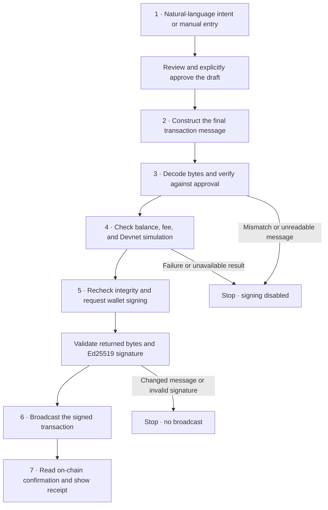
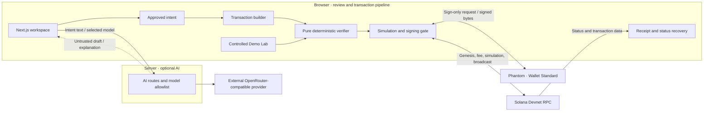

<p align="center">
  
</p>

<h1 align="center">IntentShield</h1>
<p align="center"><strong>The Intelligent Security Layer</strong></p>
<p align="center">
  Know what you sign.<br />
  Describe a SOL transfer. Review the intent. Verify the exact transaction before your wallet signs.
</p>

<p align="center">
  <a href="https://intent-shield-self.vercel.app/"><strong>Launch live app ↗</strong></a>
  &nbsp; · &nbsp;
  <a href="https://intent-shield-self.vercel.app/app/demo">Explore Security Demo Lab</a>
  &nbsp; · &nbsp;
  <a href="SECURITY.md">Security policy</a>
</p>

<p align="center">Solana Devnet · Native SOL only · Non-custodial · Up to 1 SOL per transfer</p>

> [!IMPORTANT]
> **AI drafts. Deterministic code verifies. You authorize.** An intent match means the supported transaction matches your approval; it does not establish that the recipient is trustworthy.

---

**Quick links:** [Overview](#project-overview) · [How it works](#how-it-works) · [Security](#security-architecture) · [Local setup](#getting-started) · [Test evidence](#testing--verification)

<details>
<summary>Browse the full README</summary>

- [Demo video](#demo-video)
- [Project overview](#project-overview)
- [Key features](#key-features)
- [How it works](#how-it-works)
- [Security architecture](#security-architecture)
- [Technology stack](#technology-stack)
- [Architecture & project structure](#architecture--project-structure)
- [Getting started](#getting-started)
- [AI configuration](#ai-configuration)
- [Solana Devnet setup](#solana-devnet-setup)
- [Testing & verification](#testing--verification)
- [Live demo & evidence](#live-demo--evidence)
- [Limitations & security disclaimer](#limitations--security-disclaimer)
- [Hackathon information](#hackathon-information)
- [Roadmap](#roadmap)
- [Contributing](#contributing)
- [License & acknowledgments](#license--acknowledgments)

</details>

<a id="demo-video"></a>

## 🎬 Demo video

**[Watch the IntentShield demo on YouTube ↗](https://youtu.be/eTGk3J56Zss)**

| Watch for | Product flow |
|---|---|
| Describe and review | Natural-language intent, model selection, and editable transfer fields |
| Verify and simulate | Exact-message checks and a Devnet simulation before signing |
| Sign and confirm | Explicit Phantom approval, transaction receipt, and Explorer confirmation |
| Challenge the verifier | Changed amount and lookalike recipient blocked in the Demo Lab |

Alongside the video, [open the Demo Lab](https://intent-shield-self.vercel.app/app/demo) for a wallet-free walkthrough. Its scenarios are controlled examples; they move no funds.

<a id="project-overview"></a>

## 🔎 Project overview

A wallet's **Sign** button is a high-stakes decision. A recipient address, an instruction list, or a raw transaction can be difficult to connect to what you actually meant to do. Approving without that understanding is **blind signing**.

IntentShield makes one small, useful promise: for a supported native SOL transfer, compare the transaction your wallet will sign with the transfer you explicitly approved.

You describe the transfer or enter it manually. The app turns it into a reviewable draft, builds the transaction, checks its exact message bytes, and simulates it on Solana Devnet. Your wallet is asked to sign only after those checks succeed. The receipt then separates submission from on-chain confirmation.

**Try either path:**

- **Explore without a wallet:** use the [landing simulator](https://intent-shield-self.vercel.app/#simulator) or [Security Demo Lab](https://intent-shield-self.vercel.app/app/demo).
- **Make a Devnet transfer:** open the [workspace](https://intent-shield-self.vercel.app/app), connect Phantom on Devnet, and follow the [setup guide](#solana-devnet-setup).

<a id="key-features"></a>

## ✨ Key features

| Feature | What is implemented |
|---|---|
| **AI intent parsing** | Plain language becomes an editable, schema-validated draft. Address and amount guards run on both server and client. |
| **OpenRouter model switcher** | Select from the operator's server-side allowlist; see which model answered and when fallback was used. |
| **Manual entry** | Enter recipient and amount directly when AI is unavailable or unnecessary. All transaction checks still run. |
| **Deterministic verification** | Compare source, fee payer, full recipient, integer lamports, network context, and allowed instructions against the approved intent. |
| **Solana Devnet simulation** | Check balance and fee, then simulate the same unsigned message before signing. |
| **Phantom wallet signing** | Request explicit sign-only approval through Wallet Standard, then validate the returned message and signature before broadcast. |
| **Transaction receipt** | Track submitted, confirmed, failed, or unresolved status; inspect a Devnet Explorer link and recover a wallet-scoped pending receipt. |
| **Security Demo Lab** | Run exact-match, changed-amount, lookalike-recipient, extra-instruction, and mutated-byte scenarios through the real verifier. |
| **Interactive landing** | A controlled simulator, responsive product previews, and reduced-motion-aware visuals explain the flow before connecting a wallet. |

<a id="how-it-works"></a>

## 🧭 How it works



1. **Review the intent.** Approval fixes the sender, full recipient, lamports, and Devnet context. Editing the draft invalidates approval.
2. **Verify what will be signed.** The app decodes the compiled message rather than trusting the draft or a UI summary.
3. **Simulate before signing.** An explicit successful response is required; timeout or malformed data does not count as success.
4. **Keep the reviewed bytes intact.** The app rechecks the message at the signing boundary and rejects wallet modifications.
5. **Confirm honestly.** One application broadcast request starts status tracking. Only RPC evidence of `confirmed` or `finalized`, without a transaction error, produces a confirmed receipt.

> [!NOTE]
> **Submitted ≠ confirmed.** An interrupted broadcast response can leave the result unresolved. Check the known signature before trying another transfer; the app does not automatically re-sign.

<a id="security-architecture"></a>

## 🛡️ Security architecture

### Trust boundaries

| Boundary | Responsibility and limits |
|---|---|
| **User → approved intent** | You review recipient and amount. Matching a mistaken approval still produces the wrong transfer for you. |
| **AI provider → draft** | Model output is untrusted. Schema validation and literal address/amount guards constrain it; only explicit user approval establishes intent. |
| **Message → pure verifier** | Deterministic code checks decoded bytes. The verifier has no AI, wallet, RPC, or React dependency. |
| **App → Devnet RPC** | Genesis hash, balance, fees, simulation, and confirmation come from the configured RPC. This is an RPC trust dependency, not independent consensus verification. |
| **App → wallet** | The wallet signs without sending. The app then checks exact returned bytes and the approved account's Ed25519 signature. |

### Checks that gate signing and broadcast

- **Network validation:** public configuration accepts only `devnet`; the configured RPC must report the expected Devnet genesis hash.
- **Instruction allowlist:** one native System Program transfer. The builder adds a fixed compute budget of **1,000 CU at 1 micro-lamport per CU**; other values or extra instructions are rejected. A lone transfer is also accepted by the verifier.
- **Exact intent comparison:** full recipient, source, fee payer, account roles, and `BigInt` lamports must match. Unsupported messages and address lookup tables fail closed.
- **Byte integrity:** verification and simulation bind to the same message fingerprint. The message is reverified at signing; returned message bytes must equal the reviewed bytes.
- **Signature validation:** the approved sender must be the sole signer, and its Ed25519 signature must validate before the signed wire is broadcast.
- **State integrity:** stale approvals, duplicate signing clicks, account changes, expiry, cancellation, and late wallet responses cannot authorize a new broadcast.

Simulation runs on the unsigned transaction with signature checks disabled and without replacing its blockhash. **It does not validate a wallet signature**; that validation happens after signing. The app makes one `sendTransaction` call, while the RPC may rebroadcast the same signed bytes using its retry policy.

<details>
<summary>Threat model: what is blocked, and what remains outside scope</summary>

| Threat | Implemented response |
|---|---|
| AI invents a recipient or amount | Reject ungrounded fields; require correction and explicit review |
| Recipient, amount, or instructions change | Compare decoded values and enforce the instruction allowlist |
| Bytes change after review or inside the wallet | Recheck fingerprint and byte equality; refuse broadcast |
| Wallet returns a forged signature | Verify Ed25519 signature against the approved account |
| Wrong network, failed simulation, unreadable RPC | Disable signing rather than infer success |
| Duplicate clicks or stale asynchronous work | Signing lock, approval identity, and cancellation guards |
| Broadcast response is lost | Track the known signature and preserve an unresolved state |

**Outside scope:** recipient reputation, phishing-site detection, all-scam detection, compromised browsers or wallets, malicious extensions, and arbitrary Solana programs. Simulation describes a point in time and cannot guarantee eventual execution.

</details>

See the [security policy](SECURITY.md) and the [limitations](#limitations--security-disclaimer). No independent security audit or certification is claimed.

<a id="technology-stack"></a>

## 🧰 Technology stack

Versions below are pinned in [`package.json`](package.json); [`package-lock.json`](package-lock.json) records the install graph.

| Layer | Dependencies and versions |
|---|---|
| Application | Next.js **16.4.5**, React / React DOM **19.3.1**, TypeScript **6.0.3** |
| Solana | `@solana/kit` **8.6.0**, `@solana/react` **8.6.0**, `@solana/kit-plugin-wallet` **0.23.0**, `@solana-program/system` **0.16.0** |
| UI and styling | Tailwind CSS **4.3.5**, Radix UI **1.8.1**, `lucide-react` **1.70.0**, GSAP **3.15.1** |
| Validation | Zod **4.6.7** |
| Unit and integration testing | Vitest **5.1.0**, Testing Library React **16.3.3**, jsdom **31.0.0** |
| Browser testing | Playwright **1.65.0**, axe-core Playwright **4.14.0** |
| Tooling | ESLint **9.39.5**, `tsx` **4.23.15**, Node.js **≥24** |

OpenRouter-compatible HTTP requests run server-side. There is no custom on-chain program to deploy; transfers use Solana's native System Program. The production build explicitly uses Webpack through `npm run build`.

<a id="architecture--project-structure"></a>

## 🏗️ Architecture & project structure



Intent text sent for parsing reaches the configured AI provider, including any recipient written in that text. The explanation endpoint sends bounded verdict details without addresses. Provider credentials stay in server-only modules; the browser talks directly to Devnet RPC for the transaction pipeline.

```text
IntentShield/
├── public/brand/               # Tracked SVG project mark
├── src/
│   ├── app/                    # Landing, workspace, demo, receipt, API routes
│   ├── components/             # Shared layout and UI primitives
│   ├── config/                 # Environment validation and Devnet scope
│   ├── features/
│   │   ├── intent/             # Draft parsing, model selection, approval
│   │   ├── verification/       # Message decoding and deterministic checks
│   │   ├── transfer/           # State machine, simulation, sign, submit
│   │   ├── wallet/             # Wallet Standard connection and balance
│   │   ├── receipt/            # RPC receipts and scoped recovery
│   │   ├── demo/               # Controlled verifier scenarios
│   │   └── landing/            # Marketing UI, motion, sample simulator
│   ├── lib/solana/             # RPC adapter and network guard
│   ├── server/                 # AI client, request limits, safe logging
│   ├── styles/                 # Design tokens and landing styles
│   └── test/                   # Fixtures, fakes, test setup
├── tests/                      # Unit, integration, browser suites
├── scripts/                    # Fixture generation and live Devnet smoke test
├── .github/                    # CI workflow and PR template
├── .env.example                # Public defaults; empty AI credentials
└── SECURITY.md
```

<details>
<summary>Developer map: core modules and routes</summary>

| Start here | Responsibility |
|---|---|
| [`verify-native-sol-transfer.ts`](src/features/verification/lib/verify-native-sol-transfer.ts) | Pure transaction verifier |
| [`sign-transfer.ts`](src/features/transfer/lib/sign-transfer.ts) | Byte and signature checks at the wallet boundary |
| [`machine.ts`](src/features/transfer/machine.ts) | Transfer state transitions and guards |
| [`rpc.ts`](src/lib/solana/rpc.ts) | Devnet RPC adapter |
| [`src/server/ai/`](src/server/ai/) | Configuration, provider calls, fallback, and handlers |

| Route | Purpose |
|---|---|
| `/` · `/app` · `/app/demo` | Landing, transfer workspace, controlled Demo Lab |
| `/tx/[signature]` | Public Devnet receipt lookup for a supplied signature |
| `POST /api/ai/parse-intent` | Structured, untrusted transfer draft |
| `POST /api/ai/explain` | Optional explanation of an existing verdict |
| `GET /api/ai/models` | Public allowlisted model IDs, labels, default, and availability |
| `GET /api/health` | Minimal service and cluster health payload |

</details>

<a id="getting-started"></a>

## 🚀 Getting started

### Prerequisites

- **Node.js 24 or later** and npm.
- A modern browser with WebCrypto Ed25519 support.
- For real Devnet transfers: Phantom or another Wallet Standard wallet supporting `solana:signTransaction`, plus Devnet SOL. Wallet-free demos do not need either.

### Install and run locally

```bash
git clone https://github.com/lidxgoesgiri/IntentShield.git
cd IntentShield
npm ci
cp .env.example .env.local
npm run dev
```

In PowerShell, use `Copy-Item .env.example .env.local` for the copy step. Open [localhost:3000](http://localhost:3000). The template supports manual entry immediately; AI requires the [configuration below](#ai-configuration).

### Environment variables

| Variable | Scope | Default / purpose |
|---|---|---|
| `NEXT_PUBLIC_SOLANA_RPC_URL` | Browser | `https://api.devnet.solana.com`; must report Devnet's genesis hash |
| `NEXT_PUBLIC_SOLANA_CLUSTER` | Browser | `devnet`; other values are rejected |
| `NEXT_PUBLIC_APP_URL` | Browser | `http://localhost:3000`; application metadata URL |
| `NEXT_PUBLIC_REPOSITORY_URL` | Browser | Repository link shown in the UI |
| `NEXT_PUBLIC_DOCS_URL` | Browser | Optional; defaults to the configured repository README |
| `OPENROUTER_API_KEY` | **Server only** | Empty; set privately to enable AI together with a valid model |
| `OPENROUTER_MODEL` | **Server only** | Empty; default model ID, or comma-separated IDs with the first as default |
| `OPENROUTER_MODELS` | **Server only** | Optional comma-separated additional allowed model IDs |
| `AI_BASE_URL` | **Server only** | `https://openrouter.ai/api/v1`; compatible API base URL |
| `AI_REQUESTS_PER_MINUTE` | **Server only** | `10`; best-effort per-client request limit |
| `AI_DAILY_REQUEST_BUDGET` | **Server only** | `500`; per-process daily provider-attempt budget |

Keep credentials in `.env.local` or hosting environment settings. Never prefix secrets with `NEXT_PUBLIC_`. The template is tracked; local environment files are ignored.

### Check and build

```bash
npm run lint
npm run typecheck
npm test
npm run build
npm start
```

`npm start` serves the completed production build on port 3000. For browser testing and the separate live smoke command, see [testing & verification](#testing--verification).

<a id="ai-configuration"></a>

## 🤖 AI configuration

1. Create a key in [OpenRouter's key settings](https://openrouter.ai/settings/keys), then set `OPENROUTER_API_KEY` privately in `.env.local`.
2. Copy an exact available model ID from the [OpenRouter model catalog](https://openrouter.ai/models) into `OPENROUTER_MODEL`. **There is no built-in default model.**
3. Optionally add comma-separated IDs to `OPENROUTER_MODELS`. The combined, deduplicated server allowlist supports up to 12 models.
4. Restart the local server. Open `/app` and choose a model in the composer. The selection is stored locally and restored only while still allowlisted.

The [OpenRouter quickstart](https://openrouter.ai/docs/quickstart) covers provider setup. The app's `GET /api/ai/models` endpoint exposes availability and model labels, never credentials.

| Situation | App behavior |
|---|---|
| Missing key, missing model, or invalid AI configuration | Parse/explain return `503 AI_UNAVAILABLE`; model listing reports unavailable; manual entry stays available |
| Browser requests a model outside the allowlist | Reject with HTTP `400` before calling the provider |
| Selected model fails or produces invalid output | At most one additional provider attempt: health-aware alternative, or one retry when only one model is configured |
| All attempts fail or request budget is exhausted | Show AI unavailable and offer manual entry |

**Bounded, optional assistance.** Failed models have a 60-second process-local cooldown. Calls have an 8-second timeout within an 18-second overall provider deadline. Intent input is limited to 300 characters; provider bodies are capped at 64 KiB and browser API responses at 16 KiB. Changing models cannot change the deterministic verdict or signing policy.

**Rate limits and cost control.** Parse and explain share process-local counters. Fallback consumes another provider attempt; daily counters reset in UTC. Restarts and separate serverless instances do not share these counters, so they are not a global spending cap. Provider limits and model availability apply separately; configure an account/key spending limit with the provider.

<a id="solana-devnet-setup"></a>

## 🌐 Solana Devnet setup

1. **Switch Phantom to Devnet.** Open your profile → **Settings → Developer Settings → Testnet Mode**, enable it, then choose **Solana Devnet**. See [Phantom's official testnet guide](https://help.phantom.com/articles/view-testnets-in-phantom-5997313271699).
2. **Fund the test wallet.** Copy its public address and request Devnet SOL from the [official Solana Faucet](https://faucet.solana.com/). Select Devnet; faucet availability and rate limits may vary. Devnet SOL has no monetary value.
3. **Connect in the workspace.** Open [the live app](https://intent-shield-self.vercel.app/app) or your local `/app`, connect the wallet, and check the Devnet indicator.
4. **Prepare a small transfer.** Use a different recipient's full address, for example `Send 0.01 SOL to <full recipient Devnet address>`, or select **Enter Manually**. Replace the address placeholder before submitting. The app refuses self-transfers and amounts above 1 SOL; allow enough balance for the fee.
5. **Review → verify → simulate → sign.** Check the complete address and amount. After approval and successful checks, explicitly authorize signing in Phantom.
6. **Inspect the receipt.** Wait for confirmed status and open its **Solana Explorer** link. The URL must include `cluster=devnet`.

A wallet that only supports sign-and-send cannot use this verification boundary. If the wallet inserts instructions or otherwise changes the reviewed message, IntentShield refuses to broadcast.

<a id="testing--verification"></a>

## 🧪 Testing & verification

| Command | Scope |
|---|---|
| `npm test` | Vitest unit and integration suites |
| `npm run test:watch` | Vitest watch mode |
| `npm run lint` | ESLint, including architectural import boundaries |
| `npm run typecheck` | Next.js route type generation and TypeScript checks |
| `npm run build` | Optimized production build using Webpack |
| `npm run test:e2e` | Playwright against a local production server; test wallet and mocked RPC/AI |

Install Playwright's browser before the first E2E run:

```bash
npx playwright install chromium
npm run test:e2e
```

The E2E configuration builds the app by default and serves it on port **3100**. On Linux CI, browser setup uses `npx playwright install --with-deps chromium`. For local QA with installed Chrome, PowerShell users can run:

```powershell
$env:E2E_BROWSER_CHANNEL = 'chrome'
npm run test:e2e
```

<details>
<summary>What the automated suites exercise</summary>

- **Intent and verifier:** decimal-to-lamport precision, literal AI guards, address validation, single-lamport mismatches, unsupported messages, extra instructions, lookup tables, network mismatch, and byte mutation.
- **Transaction lifecycle:** approval invalidation, fee/balance preflight, simulation errors, wallet rejection, invalid signatures, changed wallet payloads, duplicate clicks, expiry, cancellation, ambiguous submission, and receipt recovery.
- **AI boundaries:** allowlisted model selection, fallback, request budgets, bounded response reads, cancellation, and independence from verification/signing.
- **Browser experience:** full controlled transfer flow, Demo Lab, wallet-scoped receipt privacy, responsive layouts, keyboard navigation, axe accessibility checks, and reduced-motion behavior.

</details>

### Verified local results

Local verification on **8 November 2026**:

| Check | Result |
|---|---|
| Vitest unit and integration suites | **419/419 passed** across 31 files |
| Playwright browser suites | **113/113 passed** across 15 files |
| ESLint, TypeScript, production build | **Passed** |

Playwright ran in installed Chrome against the same completed local production build (`E2E_BROWSER_CHANNEL=chrome`, `E2E_SKIP_BUILD=1`), using a test wallet and mocked RPC/AI. No live AI provider or real wallet transaction was used.

These are local checks, not a claim about the latest hosted CI run. The [CI workflow](.github/workflows/ci.yml) defines separate quality and mocked-browser jobs.

### Controlled tests versus real transactions

| Evidence type | Uses real Devnet? | Signs or broadcasts? |
|---|---|---|
| Landing simulator / Security Demo Lab | No; controlled fixtures | No |
| Vitest / Playwright suites | No; fakes and mocks for external services | Test signatures only; no live broadcast |
| `npm run smoke:devnet` | Yes | Yes, with a disposable test key; not Phantom |
| Manual Phantom transfer | Yes | Yes, only after the user's wallet approval |

**Opt-in live smoke test:** `npm run smoke:devnet` exercises the production transfer modules against real Devnet, checks the confirmed on-chain message, and includes a negative amount-mismatch control. It creates or loads a disposable key in ignored `.devnet/` storage and writes local evidence under ignored `artifacts/`. Run it only when you intend to create a Devnet transaction and have the wallet owner's authorization. It was **not run for this documentation update**.

<a id="live-demo--evidence"></a>

## 🔗 Live demo & evidence

| Resource | Link / status |
|---|---|
| Production website | [intent-shield-self.vercel.app](https://intent-shield-self.vercel.app/) |
| Transfer workspace | [Open `/app`](https://intent-shield-self.vercel.app/app) |
| Wallet-free security demo | [Open `/app/demo`](https://intent-shield-self.vercel.app/app/demo) |
| Service health | [Open `/api/health`](https://intent-shield-self.vercel.app/api/health) — service status, not transaction proof |
| Solana Devnet Explorer | [Open Explorer on Devnet](https://explorer.solana.com/?cluster=devnet) |
| YouTube video | [Watch the demo](https://youtu.be/eTGk3J56Zss) |
| Public transaction signature / receipt | **Pending publication with the wallet owner's consent.** No signature is included here. |

<!-- TODO: Add an owner-approved public Devnet signature and its Explorer transaction URL. -->

The production website, workspace, Demo Lab, health endpoint, and logo returned HTTP **200** during the 8 November 2026 documentation check. Reachability is not proof of a completed wallet transaction.

Historical read-only Devnet checks are kept locally; their private artifacts are not bundled with this repository. They are separate from mocked test results and do not establish a fresh Phantom transfer on this revision. For your own evidence, use the receipt's Explorer link after confirming a transfer; sharing its signature exposes that public on-chain transaction.

<a id="limitations--security-disclaimer"></a>

## ⚠️ Limitations & security disclaimer

> [!WARNING]
> **Hackathon MVP, not universal scam protection.** IntentShield checks a narrow transaction shape against your approval. It cannot determine whether sending to that recipient is a good decision.

- **Devnet only; native SOL only; up to 1 SOL.** No mainnet, SPL tokens, NFTs, swaps, arbitrary programs, address lookup tables, or self-transfers.
- **AI can misunderstand.** Review every field. Literal guards reduce invented data; they do not prove semantic accuracy or detect every malicious request.
- **Simulation and RPC have limits.** The configured RPC is trusted for network and chain data. A successful simulation cannot guarantee inclusion or future execution.
- **Wallet/browser compatibility matters.** Sign-only Wallet Standard support and WebCrypto Ed25519 are required. Wallet modifications to reviewed bytes are blocked, including added wallet security instructions.
- **Privacy is scoped, not confidential.** Receipt recovery keeps a public signature in session storage, scoped to wallet and Devnet; it does not store private keys, signed wire payloads, or approvals. Receipt URLs are public lookups.
- **Browser security remains a dependency.** Compromised wallets, extensions, or browsers are outside scope. CSP currently allows inline hydration scripts; it does not eliminate XSS risk.
- **No independent audit is claimed.** Automated tests and internal review do not amount to security certification.

<a id="hackathon-information"></a>

## 🏁 Hackathon information

Prepared for the **MLH Solana Hackathon 2026**. The [official event page](https://events.mlh.com/events/15200-solana-hackathon) describes both AI-assisted transaction interfaces and tools that explain transactions before signing as AI Track examples.

| Consideration | IntentShield's relevance |
|---|---|
| **AI Track** | AI turns natural language into a reviewable draft and explains deterministic results; the wallet signs verified transactions that are simulated, submitted, and confirmed on Solana Devnet. |
| **Top 3 Overall** | A working end-to-end product with an explicit security boundary, reproducible controlled demos, tests, and a live deployment. This describes the submission's intended fit, not an award or eligibility determination. |

Organizer rules and eligibility decisions remain authoritative. This README does not certify eligibility or claim that every repository asset was created within the hacking window. See the [MLH standard hackathon rules](https://github.com/MLH/mlh-policies/blob/main/standard-hackathon-rules.md) alongside the event-specific terms.

### AI assistance disclosure

**Claude Code (Anthropic)** and **Codex (OpenAI)** assisted with implementation, testing, review, and documentation. The maintainer directs and reviews the work. Runtime AI is a separate, optional OpenRouter-compatible integration whose model depends on operator configuration.

Third-party libraries and assets retain their own attribution and licenses. AI assistance does not replace human review or independent security evaluation. IntentShield is not affiliated with MLH, the Solana Foundation, or any wallet provider.

<a id="roadmap"></a>

## 🗺️ Roadmap

| Available now | Future work — not implemented |
|---|---|
| Devnet native SOL transfers with explicit approval | SPL transfers with mint and precision checks |
| Deterministic verification and exact-byte signing checks | Decoding and previews for selected dApp instructions |
| AI/manual entry, model selection, and bounded fallback | Evaluation of sourced program-risk signals |
| Simulation, receipts, recovery, and controlled Demo Lab | Broader wallet compatibility and independent security review |
| Automated unit, integration, and mocked browser suites | Mainnet only after independent review and additional risk controls |

Future support must preserve explicit approval, fail-closed verification, and the separation between AI assistance and signing authority.

<a id="contributing"></a>

## 🤝 Contributing

Use [GitHub issues](https://github.com/lidxgoesgiri/IntentShield/issues) for reproducible bugs or focused proposals. For vulnerabilities, follow [SECURITY.md](SECURITY.md) and report privately.

1. Work on a short-lived branch with a focused change.
2. Keep AI output outside verification and signing authority; add regression coverage for security behavior changes.
3. Run lint, typecheck, relevant tests, and the production build. Run the mocked browser suite when the user flow changes.
4. Use Conventional Commits and open a PR against `main` with the [repository template](.github/pull_request_template.md). Label mock evidence and live transaction evidence accurately.

Do not include credentials, seed phrases, private keys, local environment files, or private evidence artifacts. Review the license status below before reusing project code.

<a id="license--acknowledgments"></a>

## 📄 License & acknowledgments

**No project-wide `LICENSE` file is currently included.** A public repository is not, by itself, an open-source license grant; contact the maintainer to clarify reuse permissions.

Third-party dependencies and assets retain their respective licenses. The UI uses Basement Grotesque by basement.studio ([bundled OFL 1.1 license](src/app/fonts/basement-grotesque/LICENSE.txt)), Instrument Sans, and IBM Plex Mono. Dependency versions and the complete package list are available in [`package.json`](package.json).
